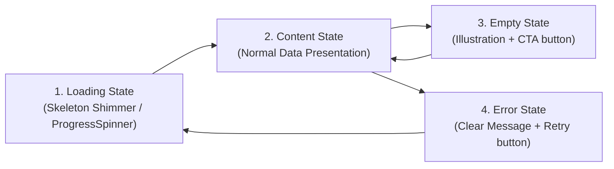

# 🎨 E-Commerce Shopping App — Design System & UI/UX Guidelines

> **Project**: E-Commerce Shopping Android Application  
> **Client / Organization**: Algions AI Labs Private Limited  
> **Target Framework**: Native Android (Kotlin + Jetpack Compose Material 3)  
> **Compliance Standard**: WCAG 2.1 AA Accessibility & Material Design 3 (M3)  

---

## 1. Design Vision & Brand Identity

The app's visual identity balances **modern e-commerce aesthetics (Shopify/Nike/Amazon style)** with **high legibility, accessibility, and clear transactional feedback**. 

### Core Principles
1. **Clarity First**: Crucial information (price, variant selection, stock status, and order state) must be prominent and unambiguous.
2. **Predictable Feedback**: Every action has distinct Loading, Success, Error, and Empty states.
3. **No False Certainty**: Never display green badges or success states until verified by the server.
4. **Accessible by Default**: Minimum $48 \times 48\,\text{dp}$ touch targets, high contrast ratios ($\ge 4.5:1$ for normal text, $\ge 3:1$ for large text/icons), and clear screen-reader semantic labels.

---

## 2. Color Palette & Semantic Tokens

### 2.1 Light Theme Palette (Primary Default)

| Token Name | Hex Code | Visual Sample | Usage & Semantic Purpose | WCAG Contrast on White |
| :--- | :--- | :--- | :--- | :--- |
| **`Primary`** | `#1E3A8A` | 🟦 Deep Royal Blue | Main app bar, primary brand accents, focused states | **10.5 : 1** (Pass AAA) |
| **`OnPrimary`** | `#FFFFFF` | ⬜ Pure White | Text & icons on `Primary` background | — |
| **`PrimaryContainer`** | `#DBEAFE` | 🟦 Soft Blue Tint | Selected category chips, active filter badges | — |
| **`OnPrimaryContainer`**| `#1E40AF` | 🟦 Dark Blue Text | Text inside `PrimaryContainer` chips | **5.8 : 1** (Pass AA) |
| **`Secondary / CTA`** | `#EA580C` | 🟧 Warm Amber/Orange | "Add to Cart", "Buy Now", prominent call-to-actions | **3.8 : 1** (Large text/buttons) |
| **`OnSecondary`** | `#FFFFFF` | ⬜ Pure White | Text & icons on `Secondary` CTA buttons | — |
| **`Background`** | `#F8FAFC` | 🌫️ Slate 50 (Off-white)| Screen background, reduces screen glare & fatigue | — |
| **`Surface`** | `#FFFFFF` | ⬜ Clean White | Card surfaces, bottom sheets, dialogs, top bars | — |
| **`SurfaceVariant`** | `#F1F5F9` | 🌫️ Slate 100 | Search bar background, variant chip backgrounds | — |
| **`OnSurface`** | `#0F172A` | ⬛ Slate 900 (Dark Navy)| Primary headings, product titles, prices | **16.1 : 1** (Pass AAA) |
| **`OnSurfaceVariant`** | `#64748B` | 🔘 Slate 500 | Secondary descriptions, subtitles, variant labels | **4.6 : 1** (Pass AA) |
| **`Outline / Border`** | `#E2E8F0` | ◽ Slate 200 | Dividers, card borders, unselected chip outlines | — |
| **`Success`** | `#16A34A` | 🟩 Emerald Green | "In Stock", "Order Confirmed", verified checkmarks | **4.5 : 1** (Pass AA) |
| **`SuccessContainer`**| `#DCFCE7` | 🟩 Light Green Tint| Background for "In Stock" and "Confirmed" badges | — |
| **`Warning`** | `#D97706` | 🟨 Amber / Ochre | "Only 2 left in stock", "Pending server confirmation"| **4.5 : 1** (Pass AA) |
| **`WarningContainer`**| `#FEF3C7` | 🟨 Warm Yellow Tint | Low stock chip background | — |
| **`Error`** | `#DC2626` | 🟥 Ruby Crimson | "Out of Stock", "Card Declined", validation error | **4.6 : 1** (Pass AA) |
| **`ErrorContainer`** | `#FEE2E2` | 🟥 Soft Red Tint | Out-of-stock badge background, error alert banner | — |

---

### 2.2 Dark Theme Palette (Night / Low-Light Mode)

| Token Name | Hex Code | Visual Sample | Usage & Purpose |
| :--- | :--- | :--- | :--- |
| **`Primary`** | `#60A5FA` | 🟦 Electric Blue | Accent highlights on dark backgrounds |
| **`OnPrimary`** | `#0F172A` | ⬛ Deep Navy | Text on `Primary` button |
| **`Secondary / CTA`** | `#FB923C` | 🟧 Bright Orange | Primary actions in dark mode |
| **`Background`** | `#0B0F19` | ⬛ Deep Slate 950 | OLED-friendly screen background |
| **`Surface`** | `#131C2E` | ⬛ Midnight Navy | Elevated cards, sheets, dialogs |
| **`SurfaceVariant`** | `#1E293B` | ⬛ Slate 800 | Search bars, unselected chips |
| **`OnSurface`** | `#F8FAFC` | ⬜ Off-white | Main headings and labels |
| **`OnSurfaceVariant`** | `#94A3B8` | 🔘 Slate 400 | Secondary labels and helper text |
| **`Outline`** | `#334155` | ◽ Slate 700 | Borders and dividers |
| **`Success`** | `#4ADE80` | 🟩 Light Emerald | Success states & "In Stock" |
| **`Error`** | `#F87171` | 🟥 Coral Red | Error messages & out-of-stock |

---

## 3. Typography System (Material 3 Type Scale)

Standard font family: **System Default (Roboto / Sans-Serif)** for guaranteed native performance and zero external font bundle delay.

| Style Name | Font Weight | Size (`sp`) | Line Height (`sp`) | Letter Spacing (`sp`) | Primary Use Cases |
| :--- | :--- | :--- | :--- | :--- | :--- |
| **`DisplayLarge`** | Bold (700) | `32` | `40` | `-0.25` | Welcome hero headers, Order confirmation banner |
| **`HeadlineMedium`**| SemiBold (600)| `24` | `32` | `0.0` | Screen Titles (e.g. "Shopping Cart", "Order #1042") |
| **`HeadlineSmall`** | SemiBold (600)| `20` | `28` | `0.0` | Section headers (e.g. "Delivery Address", "Payment Method") |
| **`TitleLarge`** | SemiBold (600)| `18` | `24` | `0.0` | Product names on Detail Screen, Order Total Amount |
| **`TitleMedium`** | Medium (500) | `16` | `24` | `0.15` | Product title on Catalog Card, Dialog titles |
| **`TitleSmall`** | Medium (500) | `14` | `20` | `0.1` | Category chip labels, Price breakdown labels |
| **`BodyLarge`** | Normal (400) | `16` | `24` | `0.5` | Product description prose, form inputs |
| **`BodyMedium`** | Normal (400) | `14` | `20` | `0.25` | Address preview, delivery options description |
| **`BodySmall`** | Normal (400) | `12` | `16` | `0.4` | Helper text, timestamp, secondary attributes |
| **`LabelLarge`** | SemiBold (600)| `14` | `20` | `0.1` | Button labels ("Add to Cart", "Checkout", "Retry") |
| **`LabelMedium`** | SemiBold (600)| `12` | `16` | `0.5` | Stock status badges ("IN STOCK", "ONLY 2 LEFT") |
| **`LabelSmall`** | Medium (500) | `10` | `14` | `0.5` | Variant tags (Size, Color), discount percentage tags |

---

## 4. Spacing, Grid & Layout Rules

The layout is built upon an **8-Point Spatial Grid** (with 4dp sub-grid for fine adjustments).

### 4.1 Spacing Tokens
- **`space4`** (`4dp`): Micro spacing (icon-to-text spacing inside badges).
- **`space8`** (`8dp`): Compact spacing (gap between chips, padding inside small badges).
- **`space12`** (`12dp`): Medium-compact spacing (gap between catalog grid columns).
- **`space16`** (`16dp`): Standard screen padding (left/right margins of screens, card inner padding).
- **`space24`** (`24dp`): Section spacing (gap between Product Gallery and Price/Variant section).
- **`space32`** (`32dp`): Major spacing (top spacing for Empty States or Auth Headers).

### 4.2 Sizing & Touch Targets
- **Minimum Interactive Touch Target**: $48 \times 48\,\text{dp}$ (WCAG 2.5.5 / Android A11y guideline).  
  *Even if a visual button is 36dp tall, its click padding must extend to at least 48dp.*
- **Top App Bar Height**: $64\,\text{dp}$.
- **Bottom Navigation Bar Height**: $80\,\text{dp}$ (standard M3 navigation bar).
- **Primary CTA Button Height**: $52\,\text{dp}$ with rounded corners ($12\,\text{dp}$).
- **Catalog Grid**: 2-column adaptive grid on mobile phones (`min 160dp` per item) with `12dp` horizontal & vertical gaps.

---

## 5. Shape & Elevation Standards

| Element | Corner Radius | Elevation | Outline Border |
| :--- | :--- | :--- | :--- |
| **Product Card** | `16dp` (`RoundedCornerShape(16.dp)`) | `2dp` (default), `6dp` (pressed) | `1dp` solid `#E2E8F0` |
| **Primary Button** | `14dp` (`RoundedCornerShape(14.dp)`) | `0dp` (flat modern design) | None |
| **Chips (Categories/Variants)** | `10dp` or Full Pill (`CircleShape`) | `0dp` | `1dp` solid `#E2E8F0` (unselected) |
| **Bottom Sheet** | `28dp` Top corners (`TopStart=28, TopEnd=28`) | `8dp` with Modal Scrim | None |
| **Text Input Fields** | `12dp` (`RoundedCornerShape(12.dp)`) | `0dp` | `1dp` `#CBD5E1` (unfocused), `2dp` `#1E3A8A` (focused) |
| **Quantity Stepper** | `10dp` (`RoundedCornerShape(10.dp)`) | `0dp` | `1dp` solid `#E2E8F0` |

---

## 6. Component Specifications & Behavior

### 6.1 Product Card (Catalog Screen)
- **Top Area**: Product image with $1:1$ aspect ratio, rounded top corners (`16dp`), with a subtle placeholder shimmer while loading.
- **Top-Right Overlay**: Stock status pill (e.g. `In Stock` in green, or `Out of Stock` in red).
- **Bottom Area**:
  - Category tag in small muted uppercase (`ELECTRONICS`).
  - Product title truncated cleanly at 2 lines.
  - Price row: Bold primary price (e.g. `$299.00`) and optional struck-through original price (`$349.00`).
  - Rating star icon (`#F59E0B`) with rating count `4.8 (120)`.

### 6.2 Product Detail Screen
- **Image Gallery**: Large edge-to-edge or padded image carousel with page indicator dots.
- **Variant Selector**:
  - **Color**: Circular color swatches ($36\text{dp}$) with an outer ring when selected.
  - **Size**: Rounded rectangular chips (S, M, L, XL, 64GB, 128GB, etc.).
- **Live Inventory Indicator**:
  - If $>5$ in stock: `"In Stock (12 available)"` in emerald green.
  - If $1 \dots 5$: `"Hurry! Only 2 left in stock"` in amber warning.
  - If $0$: `"Currently Out of Stock"` in red.
- **Sticky Bottom Action Bar**:
  - Left: Quantity selector (`-` `[ 1 ]` `+`). Max clamped to actual available stock.
  - Right: Large "Add to Cart" button ($52\text{dp}$). Disabled with tooltip when stock is 0.

### 6.3 Cart Screen
- **Item Row**:
  - Product thumbnail ($72 \times 72\,\text{dp}$).
  - Name, selected variant details ("Color: Black | Size: M").
  - Unit price and subtotal.
  - Interactive stepper (`-` / `+`) that validates against max stock. Tapping `-` at 1 prompts for removal.
  - Delete icon with accessible label (`contentDescription = "Remove item"`).
- **Sticky Order Summary Card**:
  - Subtotal, Shipping (Free or $5.00), Tax (8%), Grand Total.
  - Prominent "Proceed to Checkout" button.

### 6.4 Checkout & Simulated Payment Section
- **Delivery Address**: Card with pre-filled demo address + "Edit" or input fields with real-time validation.
- **Payment Method & Simulation Modes**:
  - Standard Card Input (Number, Expiry, CVV).
  - **Demonstration Selector (Critical for Assessment)**:
    - `[🟢 Normal Success (201 Created)]`
    - `[🟡 Insufficient Funds / Declined (402)]`
    - `[🔴 Out of Stock Conflict (409)]`
    - `[⏱️ Gateway Timeout / Network Drop (504)]`
- **Safety Rule**: "Pay Now" button triggers an explicit loading indicator with debouncing (disables double taps). It **never navigates to success** until the backend responds with HTTP 201.

### 6.5 Order Confirmation & Status Screen
- **Confirmation Card**: Green checkmark illustration with Order ID `#ORD-XXXXX`.
- **Order Tracking Timeline**:
  - Step 1: `Order Placed` (Completed)
  - Step 2: `Payment Confirmed` (Completed)
  - Step 3: `Processing & Packed` (In Progress)
  - Step 4: `Out for Delivery` (Upcoming)
  - Step 5: `Delivered` (Upcoming)

---

## 7. Universal UI State Guidelines

Every screen and feature in the app handles all 4 states gracefully:



1. **Loading State**:
   - Do not freeze the screen with a blank surface.
   - Use Compose shimmer placeholders for cards and text blocks, or a centered `CircularProgressIndicator` with accessible status text.
2. **Empty State**:
   - **Cart Empty**: Shows a shopping bag icon, "Your cart is empty", and a "Start Shopping" button that navigates to Catalog.
   - **Order History Empty**: "No orders placed yet", with an "Explore Products" button.
   - **Search Empty**: "No products match 'xyz'", with a "Clear Search" chip.
3. **Error State**:
   - Never show raw stack traces or cryptic HTTP codes.
   - Show user-friendly error copy: *"Unable to load catalog. Please check your internet connection."*
   - Always include an interactive **"Retry"** button.
4. **Offline State**:
   - A subtle top/bottom banner: *"You are currently offline. Showing cached catalog."*
   - Read-only data is accessible; checkout button notifies user that connection is required to complete orders.

---

## 8. Jetpack Compose Theme Implementation Blueprint

This design system translates directly into the following Kotlin files in `e_commerce_app.com.ui.theme`:

### `Color.kt`
```kotlin
package e_commerce_app.com.ui.theme

import androidx.compose.ui.graphics.Color

// Primary Brand Colors
val PrimaryBlue = Color(0xFF1E3A8A)
val PrimaryBlueDark = Color(0xFF60A5FA)
val PrimaryBlueContainer = Color(0xFFDBEAFE)
val OnPrimaryBlueContainer = Color(0xFF1E40AF)

// Secondary & CTA Colors
val OrangeCTA = Color(0xFFEA580C)
val OrangeCTALight = Color(0xFFFB923C)

// Surfaces & Backgrounds (Light)
val BackgroundLight = Color(0xFFF8FAFC)
val SurfaceLight = Color(0xFFFFFFFF)
val SurfaceVariantLight = Color(0xFFF1F5F9)
val OutlineLight = Color(0xFFE2E8F0)
val TextPrimaryLight = Color(0xFF0F172A)
val TextSecondaryLight = Color(0xFF64748B)

// Surfaces & Backgrounds (Dark)
val BackgroundDark = Color(0xFF0B0F19)
val SurfaceDark = Color(0xFF131C2E)
val SurfaceVariantDark = Color(0xFF1E293B)
val OutlineDark = Color(0xFF334155)
val TextPrimaryDark = Color(0xFFF8FAFC)
val TextSecondaryDark = Color(0xFF94A3B8)

// Semantic State Colors
val SuccessGreen = Color(0xFF16A34A)
val SuccessContainer = Color(0xFFDCFCE7)
val WarningAmber = Color(0xFFD97706)
val WarningContainer = Color(0xFFFEF3C7)
val ErrorRed = Color(0xFFDC2626)
val ErrorContainer = Color(0xFFFEE2E2)
```

### `Theme.kt`
```kotlin
package e_commerce_app.com.ui.theme

import androidx.compose.foundation.isSystemInDarkTheme
import androidx.compose.material3.MaterialTheme
import androidx.compose.material3.darkColorScheme
import androidx.compose.material3.lightColorScheme
import androidx.compose.runtime.Composable
import androidx.compose.ui.graphics.Color

private val LightColors = lightColorScheme(
    primary = PrimaryBlue,
    onPrimary = Color.White,
    primaryContainer = PrimaryBlueContainer,
    onPrimaryContainer = OnPrimaryBlueContainer,
    secondary = OrangeCTA,
    onSecondary = Color.White,
    background = BackgroundLight,
    surface = SurfaceLight,
    surfaceVariant = SurfaceVariantLight,
    onBackground = TextPrimaryLight,
    onSurface = TextPrimaryLight,
    onSurfaceVariant = TextSecondaryLight,
    outline = OutlineLight,
    error = ErrorRed,
    errorContainer = ErrorContainer,
    onError = Color.White
)

private val DarkColors = darkColorScheme(
    primary = PrimaryBlueDark,
    onPrimary = Color(0xFF0F172A),
    secondary = OrangeCTALight,
    onSecondary = Color.White,
    background = BackgroundDark,
    surface = SurfaceDark,
    surfaceVariant = SurfaceVariantDark,
    onBackground = TextPrimaryDark,
    onSurface = TextPrimaryDark,
    onSurfaceVariant = TextSecondaryDark,
    outline = OutlineDark,
    error = ErrorRed,
    errorContainer = ErrorContainer,
    onError = Color.White
)

@Composable
fun ECommerce_AppTheme(
    darkTheme: Boolean = isSystemInDarkTheme(),
    content: @Composable () -> Unit
) {
    val colors = if (darkTheme) DarkColors else LightColors

    MaterialTheme(
        colorScheme = colors,
        typography = Typography,
        content = content
    )
}
```

---

## 9. Developer Guidelines & Reusability Rules

1. **Never Hardcode Colors**: Always access colors via `MaterialTheme.colorScheme.*` (e.g., `MaterialTheme.colorScheme.primary`, `MaterialTheme.colorScheme.surface`).
2. **Never Hardcode Text Sizes**: Always use `MaterialTheme.typography.*` styles.
3. **Consistent Spacing**: Use standard multiples of 4dp / 8dp (`8.dp`, `12.dp`, `16.dp`, `24.dp`).
4. **Touch Target Enforcement**: Any clickable icon or button must have `Modifier.sizeIn(minWidth = 48.dp, minHeight = 48.dp)`.
5. **Image Loading**: Always wrap Coil `AsyncImage` with placeholder shimmer, error fallback icon, and semantic `contentDescription`.

