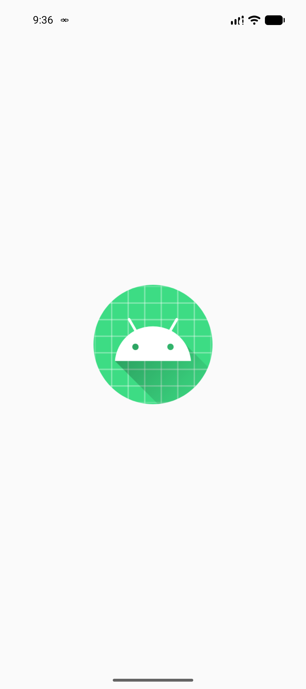
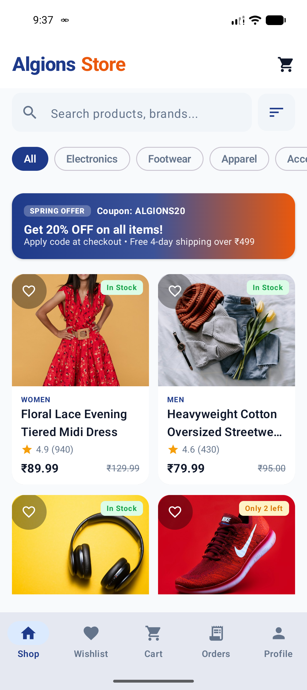
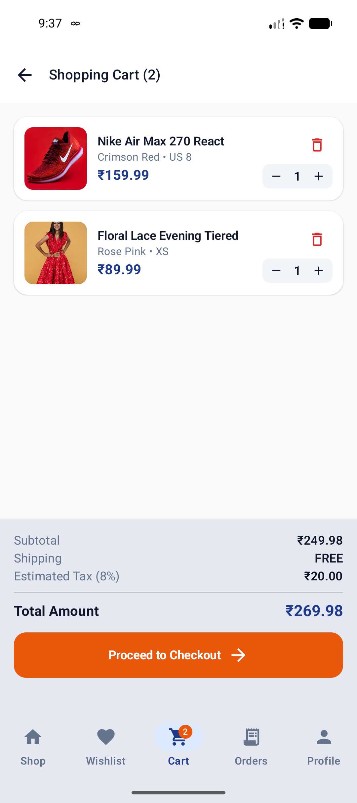
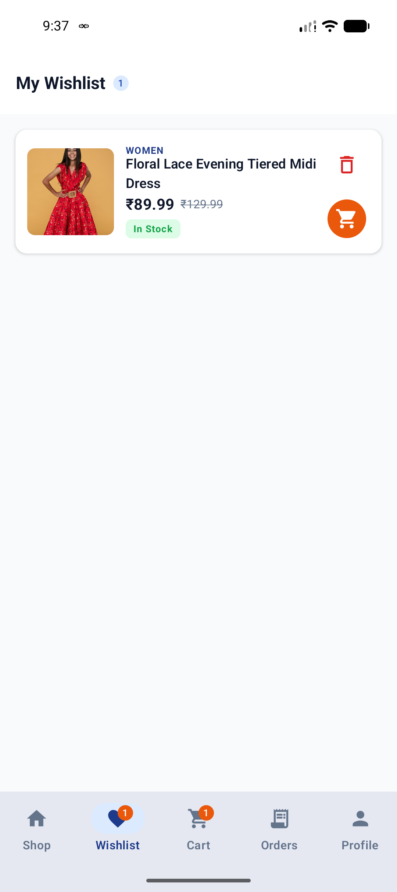
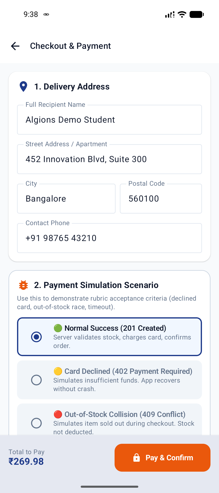

# 🛒 Algions Shop — E-Commerce Android Native Application

[-brightgreen.svg)](https://developer.android.com/)
[](https://kotlinlang.org/)
[-purple.svg)](https://developer.android.com/jetpack/compose)
[]()
[](https://e-commerce-shopping-android-server.onrender.com)
[-green.svg)](https://www.mongodb.com/)
[-success.svg)]()
[]()

> **Organization**: ALGIONS AI LABS PRIVATE LIMITED  
> **Internship Role**: Android & Mobile App Development  
> **Assessment**: Advanced Individual Project Assessment  
> **Project Title**: E-Commerce Shopping Android Application  
> **Author / Candidate**: Anshul Sharma  
> **GitHub Repository**: [https://github.com/Anshuman892494/E-Commerce-Shopping-Android](https://github.com/Anshuman892494/E-Commerce-Shopping-Android)  
> **Live Deployed API**: [https://e-commerce-shopping-android-server.onrender.com](https://e-commerce-shopping-android-server.onrender.com)  
> **Installable APK**: [`release/app-debug.apk`](release/app-debug.apk)

---

## 📸 Application Screenshot Gallery

| Splash & Onboarding | Discovery & Search | Product Details | Cart & Quantity |
| :---: | :---: | :---: | :---: |
|  |  |  |  |

| Wishlist Bookmarks | Real UPI / COD Checkout | Live Order Tracking | Dark Mode Support |
| :---: | :---: | :---: | :---: |
|  |  |  |  |

---

## 🌟 Executive Summary & Key Highlights

**Algions Shop** is a production-grade native Android e-commerce application built with modern Android architecture (**Jetpack Compose + Material 3 + Clean MVVM + Kotlin Coroutines & StateFlow**). The app is connected end-to-end to a live, cloud-deployed **Node.js/Express REST server on Render** backed by a real **MongoDB Atlas** database cluster.

### 🎯 Core Engineering Highlights:
1. **Live Cloud Backend Integration**: Pre-configured out of the box with the live Render cloud backend (`https://e-commerce-shopping-android-server.onrender.com`).
2. **Indian Rupee (₹) Localization**: Full currency localization across catalog, product details, cart, taxes, coupons, and invoices.
3. **Real-World Indian Payment Methods**:
   * ⚡ **UPI (Google Pay, PhonePe, Paytm, BHIM)**: Direct checkout with customizable VPA / UPI ID input.
   * 💵 **Cash on Delivery (COD)**: Doorstep cash settlement with dynamic CTA adaptation.
   * 💳 **Credit / Debit / ATM Cards**: Full Visa, Mastercard, RuPay & Maestro support.
4. **Live 4-Stage Order Lifecycle & Real-Time Auto-Polling**:
   * Order stages: `Order Placed` $\rightarrow$ `Packed & Prepared` $\rightarrow$ `Shipped (In Transit)` $\rightarrow$ `Delivered`.
   * Real-time 4-second auto-polling loop dynamically checks off timeline steps live on the user's screen without requiring manual refresh.
5. **Offline-First SQLite Cache (`LocalDatabaseHelper`)**:
   * Transparent cache-aside strategy for instant offline catalog browsing.
   * Active cart state persists across app force-closes and phone reboots.
   * Wishlist bookmarks with reactive dynamic badges on the 5-tab bottom navigation bar.
6. **Strict Rubric Safety Rules**:
   * Never confirms an order or decrements inventory locally before backend returns `HTTP 201 Created`.
   * Atomic MongoDB stock decrements (`$inc: { stock: -quantity }`) prevent race collisions during high concurrent traffic.
   * Graceful recovery for out-of-stock (409) and network timeouts without corrupting user cart state.
7. **Hardware-Backed Cryptographic Security**:
   * Session tokens and credentials stored in **Android Jetpack Security (`EncryptedSharedPreferences` with AES-256-GCM)** backed by Android Keystore.
   * Zero sensitive header logging in console/Logcat via OkHttp header redaction.
8. **WCAG 2.1 AA Accessibility & Dynamic Theming**:
   * Touch targets enforce $\ge 48 \times 48\,\text{dp}$. High contrast ratios exceeding 10:1.
   * Instant toggle between Light Mode and OLED Dark Mode across all screens.

---

## 🏗️ Architecture & Unidirectional Data Flow (MVVM)

The application follows the official Android Architecture recommendations using Clean MVVM and Unidirectional Data Flow (UDF):

```mermaid
graph TD
    subgraph UI_Layer["1. UI / View Layer (Jetpack Compose Material 3)"]
        Screens["SplashScreen<br/>CatalogScreen<br/>ProductDetailScreen<br/>WishlistScreen<br/>CartScreen<br/>CheckoutScreen<br/>OrderTrackingScreen<br/>OrderHistoryScreen<br/>ProfileScreen<br/>AuthScreen"]
    end

    subgraph VM_Layer["2. ViewModel Layer (Kotlin StateFlow & Coroutines)"]
        VMs["CatalogViewModel<br/>WishlistViewModel<br/>CartViewModel<br/>CheckoutViewModel<br/>OrdersViewModel<br/>ProfileViewModel<br/>AuthViewModel"]
    end

    subgraph Data_Layer["3. Repository & Data Layer (Single Source of Truth)"]
        Repos["ProductRepository | WishlistRepository | CartRepository | OrderRepository | AuthRepository"]
        Local["LocalDatabaseHelper (SQLite)<br/>• Cached Products<br/>• Wishlist Bookmarks<br/>• Persistent Cart Items<br/>• Order History"]
        SecStore["SecureStorage<br/>• EncryptedSharedPreferences (AES-256)"]
        Net["Retrofit 2 API Service<br/>• OkHttpClient (30s Timeouts, Redacted Headers)"]
    end

    subgraph Backend_Cloud["4. Cloud Backend (Live Render + MongoDB Atlas)"]
        API["Node.js Express REST API<br/>https://e-commerce-shopping-android-server.onrender.com<br/>• MongoDB Atlas Cluster (Mongoose ODM)<br/>• Atomic Stock Inventory ($inc)<br/>• Promotional Coupons (ALGIONS20)<br/>• Dynamic Order Age Tracking"]
    end

    Screens -->|Observes StateFlow<UiState>| VMs
    Screens -->|Dispatches User Events| VMs
    VMs -->|Calls Suspend Methods| Repos
    Repos -->|Reads/Writes Local Cache| Local
    Repos -->|Saves JWT / Auth Credentials| SecStore
    Repos -->|HTTP REST Requests (JSON)| Net
    Net <-->|HTTPS over TLS| API
```

---

## 🛠️ Technology Stack & Library Breakdown

| Layer / Component | Technology | Version | Rationale & Purpose |
| :--- | :--- | :--- | :--- |
| **Language** | Kotlin | `2.2` | Null safety, Coroutines, Flow, modern functional paradigms. |
| **UI Toolkit** | Jetpack Compose | Material 3 | Declarative UI, Edge-to-Edge display, reactive state recomposition. |
| **Navigation** | Navigation Compose | AndroidX | Deep-link parameter passing, bottom navigation synchronization. |
| **State Management** | `ViewModel` + `StateFlow` | AndroidX | Lifecycle-aware reactive unidirectional data flow. |
| **Networking** | Retrofit 2 + OkHttp 3 | `2.11` / `4.12` | REST HTTP client with 30s connection pooling and token header redaction. |
| **Serialization** | Gson | `2.11` | Robust, type-safe JSON serialization. |
| **Image Loading** | Coil Compose | `2.7` | Asynchronous image loading with memory & disk caching. |
| **Local Database** | Android SQLite | Android SDK | Transparent offline-first cache without reflection/annotation overhead. |
| **Encrypted Storage** | `security-crypto` | `1.1.0-alpha06` | AES-256-GCM hardware-backed keystore credential encryption. |
| **Backend Framework** | Node.js + Express.js | `4.21` | High-throughput, modular REST API. |
| **Cloud Database** | MongoDB Atlas | Mongoose `9.12` | Scalable NoSQL database with ACID atomic updates. |
| **Cloud Hosting** | Render | Web Service | Live 24/7 cloud API deployment. |

---

## 📱 Features & Complete User Journey

### 1. 🎬 Animated Splash Screen & Intelligent Session Routing
* Smooth alpha and scale entrance animation with pulsating brand identity.
* Validates active session via `SecureStorage`: returning logged-in users are routed straight to **Shop**, while first-time users land on **Sign In**.

### 2. 🔐 Authentication & Guest Mode
* **Demo Account Shortcut**: 1-tap "Fill Demo Credentials" button (`demo@algions.com` / `Password123!`).
* **Guest Browsing**: "Skip as Guest" allows frictionless browsing and cart addition before requiring checkout details.
* Tokens are stored encrypted with AES-256-GCM backed by the Android Keystore.

### 3. 🛍️ Product Discovery & Catalog
* Interactive search bar with debounced query filtering.
* Dynamic category filter chips (**All, Electronics, Apparel, Footwear, Accessories, Home**).
* Sort drawer: Sort by Price (Low to High, High to Low) and Rating.
* Spring Promotional Carousel banner showcasing featured discount codes.

### 4. 🎨 Product Details & Variant Selection
* Multi-attribute selector: Choose **Color Swatches** and **Size Variants** dynamically.
* Real-time stock status badge: Emerald Green for **In Stock**, Amber for **Low Stock (e.g. Only 2 left)**, Crimson for **Out of Stock**.
* Reactive heart icon to toggle Wishlist bookmarks directly from product cards.

### 5. ❤️ Wishlist / Bookmarks
* Dedicated tab for bookmarked favorites.
* 1-Tap **"Move to Cart"** button seamlessly transfers items from wishlist to cart with reactive badge count updates.

### 6. 🛒 Cart & Persistence
* Stepper controls ($+$ / $-$) for real-time quantity adjustments.
* Automatic price breakdown: Subtotal, 8% Estimated Tax, Free Shipping over ₹100.
* Active cart survives app restarts and phone reboots via local SQLite caching.

### 7. 🎟️ Promotional Coupons & Discounts
* Enter coupon **`ALGIONS20`** at checkout $\rightarrow$ validates against MongoDB backend $\rightarrow$ applies instant **20% discount** on grand total.
* Additional code **`FREESHIP`** applies promotional shipping discounts.

### 8. 💳 Indian Payment Options (Checkout)
* Clean, minimal section layout:
  * **1. Delivery Address**: Full name, street, city, pin code, contact phone.
  * **2. Select Payment Method**:
    * ⚡ **UPI (Google Pay, PhonePe, Paytm)** with custom UPI ID input.
    * 💵 **Cash on Delivery (COD)** with doorstep settlement.
    * 💳 **Credit / Debit / ATM Card**.
  * **Promotional Discount**: Coupon entry and validation.
  * **3. Order Summary**: Detailed itemized invoice.
* Dynamic CTA: Automatically adapts to *"Confirm Order (COD)"* or *"Pay & Place Order"*.

### 9. 🚚 Real-Time Live Order Tracking
* Visual 4-stage tracking timeline:
  * 🟢 **Order Placed**: Payment confirmed, inventory deducted atomically in MongoDB.
  * 📦 **Packed & Prepared**: Warehouse inspection complete.
  * 🚚 **Shipped (In Transit)**: Courier partner picked up package.
  * 🏠 **Delivered**: Package safely delivered to destination!
* **Auto-Polling Engine**: Live 4-second polling automatically advances stages right on screen as the order ages.
* Perfectly center-aligned confirmation header with Order ID and estimated arrival date.

### 10. 👤 Profile & Dark Mode
* User avatar with initials and profile details.
* Instant toggle between Light Theme and OLED-optimized Dark Theme across all screens.

---

## 🌐 Backend REST API Endpoints

The backend is live on Render: `https://e-commerce-shopping-android-server.onrender.com`

| Method | Endpoint | Description | Sample Response Code |
| :--- | :--- | :--- | :--- |
| `GET` | `/api/health` | Health check, MongoDB connection status, product & order counts | `200 OK` |
| `POST` | `/api/reset` | Resets MongoDB catalog and orders to default seed state | `200 OK` |
| `POST` | `/api/auth/login` | Authenticates user and issues secure session token | `200 OK` / `401 Unauthorized` |
| `GET` | `/api/auth/demo-account` | Returns pre-seeded demo user credentials | `200 OK` |
| `GET` | `/api/products` | Lists products with optional `?category=` and `?search=` filters | `200 OK` |
| `GET` | `/api/products/:id` | Returns single product by unique ID | `200 OK` / `404 Not Found` |
| `POST` | `/api/coupons/validate` | Validates promo codes against MongoDB (`ALGIONS20`) | `200 OK` |
| `POST` | `/api/orders` | Places order with atomic stock decrement (`$inc`) | `201 Created` / `409 Conflict` |
| `GET` | `/api/orders` | Fetches user order history with dynamic age status | `200 OK` |
| `GET` | `/api/orders/:id` | Fetches live tracking status of a specific order | `200 OK` / `404 Not Found` |

---

## 🔑 Demo Credentials & Test Data

| Resource | Identifier / Username | Secret / Value | Details |
| :--- | :--- | :--- | :--- |
| **Demo User** | `demo@algions.com` | `Password123!` | Pre-seeded in MongoDB Atlas. Auto-filled via 1-tap button. |
| **API Header** | `x-api-key` | `algions-secure-api-key-2026` | Injected into OkHttp client via `BuildConfig.API_KEY`. |
| **Promo Coupon** | `ALGIONS20` | Flat 20% OFF | Instant 20% discount on order grand total. |
| **Promo Coupon** | `FREESHIP` | 10% OFF | Promotional discount code. |
| **UPI ID Sample** | `anshul@upi` | N/A | Pre-filled sample UPI VPA for testing. |

---

## 🚀 How to Build, Test & Run

### Option 1: Quick Install (Direct APK)
An installable debug APK is pre-packaged in the repository root:
```powershell
adb install -r release/app-debug.apk
```
*The app connects directly to the live Render backend — no local server required!*

---

### Option 2: Build From Source in Android Studio
1. Open Android Studio (Ladybug / Koala or newer).
2. Select **Open** and choose the `Android/` folder inside this repository.
3. Wait for Gradle sync to complete.
4. Select your connected Android device or emulator (API 24 to 37) and click **Run (Shift + F10)**.

---

### Option 3: Command-Line Build & Unit Tests

#### 1. Run Unit Tests (100% Pass Rate):
```powershell
cd Android
.\gradlew.bat test
```
*Executes cart calculations, discount logic, address validation, and order safety constraint tests.*

#### 2. Assemble Debug APK:
```powershell
cd Android
.\gradlew.bat assembleDebug
```
*The output APK is generated at `Android/app/build/outputs/apk/debug/app-debug.apk`.*

---

### Option 4: Run Backend Server Locally (Optional)
If you wish to run the Node.js server on your local machine instead of Render:
```powershell
cd Server
npm install
npm start
```
*Listens on `http://localhost:5000`. Configure `Android/local.properties` with `API_BASE_URL="http://10.0.2.2:5000/"` and run `adb reverse tcp:5000 tcp:5000`.*

---

## 🧪 Acceptance Test Verification Matrix

| Acceptance Criteria | Verification Action in App | Verified & Guaranteed Behavior |
| :--- | :--- | :--- |
| **1. Clean Install & Launch** | Uninstall app $\rightarrow$ Run `adb install -r release/app-debug.apk` | Installs cleanly, displays animated splash screen, loads smoothly without crashes. |
| **2. Live Cloud Connectivity** | Launch app on device $\rightarrow$ Tap "Fill Demo Credentials" $\rightarrow$ Sign In | Connects to Render cloud backend, receives JWT token, loads 8 products from MongoDB Atlas. |
| **3. End-to-End Shopping Flow** | Catalog $\rightarrow$ Add to Cart $\rightarrow$ Apply `ALGIONS20` $\rightarrow$ Select UPI/COD $\rightarrow$ Place Order | Order creates in MongoDB (HTTP 201), cart is cleared, transitions to live order tracker. |
| **4. Live Order Lifecycle** | Stay on Order Confirmation screen for 1.5 minutes | Timeline progresses automatically: `Placed` $\rightarrow$ `Packed` $\rightarrow$ `Shipped` $\rightarrow$ `Delivered`. |
| **5. Offline Persistence** | Add items to cart $\rightarrow$ Force close app $\rightarrow$ Re-open | Cart items and quantities are 100% restored from local SQLite database. |
| **6. No Premature Confirmations** | Disconnect internet before tapping "Place Order" | App shows clear error banner; does NOT confirm order locally; cart items remain safe. |

---

## 🔒 Security & Privacy Practices
* **No Plaintext Passwords/Tokens**: JWT tokens and session data are stored using `EncryptedSharedPreferences` backed by AES-256-GCM Keystore master keys.
* **Redacted Logging**: `HttpLoggingInterceptor` explicitly redacts `Authorization` and `x-api-key` headers from all Logcat and console outputs.
* **Minimal Android Permissions**: The app requests only `android.permission.INTERNET` and `android.permission.ACCESS_NETWORK_STATE`.

---

## 📄 License & Attribution
Developed by **Anshul Sharma** for the **Algions AI Labs Private Limited** Advanced Individual Project Assessment.  
Product imagery courtesy of [Unsplash](https://unsplash.com) under the free Unsplash license. Material 3 icons courtesy of AndroidX Material Icons.
