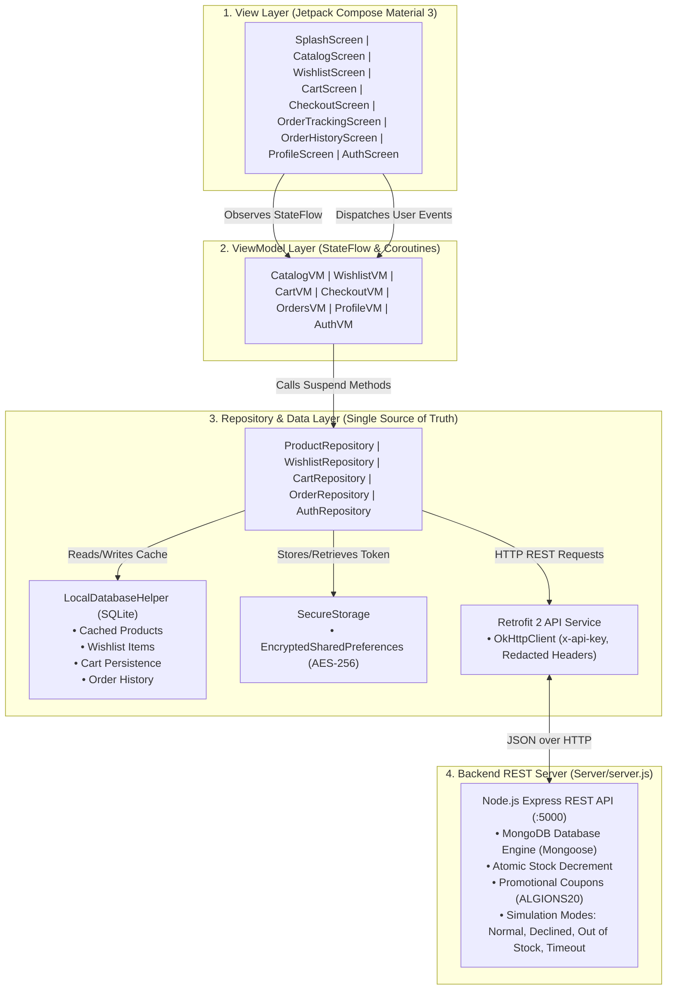

# 🛒 E-Commerce Shopping Android Application

[](https://developer.android.com/)
[](https://kotlinlang.org/)
[-purple.svg)](https://developer.android.com/jetpack/compose)
[]()
[](https://nodejs.org/)
[-green.svg)](https://www.mongodb.com/)
[-success.svg)]()

> **Organization**: ALGIONS AI LABS PRIVATE LIMITED  
> **Internship Role**: Android & Mobile App Development  
> **Assessment**: Advanced Individual Project Assessment  
> **Allocated Project**: E-Commerce Shopping Android Application  
> **GitHub Repository**: [https://github.com/Anshuman892494/E-Commerce-Shopping-Android.git](https://github.com/Anshuman892494/E-Commerce-Shopping-Android.git)

---

## 📋 Candidate Information
| Field | Details |
| :--- | :--- |
| **Student Name** | Anshul Sharma |
| **Role** | Android & Mobile App Development |
| **Assigned Project** | E-Commerce Shopping Android Application |
| **Submission Package** | Source Code, MongoDB Backend REST Server, Installable APK, Unit Tests, Documentation |

---

## 🌟 Executive Summary & Key Highlights
This project is an installable native Android shopping app delivering a complete end-to-end user journey:
**Animated Splash Screen** $\rightarrow$ **Product Discovery** $\rightarrow$ **Promo Banner & Coupon** $\rightarrow$ **Search & Category Filtering** $\rightarrow$ **Variant Selection (Color & Size)** $\rightarrow$ **Wishlist / Favorites** $\rightarrow$ **Stock Validation** $\rightarrow$ **Cart Management** $\rightarrow$ **Address Checkout & Coupon Discount** $\rightarrow$ **Simulated Payment Gateway** $\rightarrow$ **Order Confirmation** $\rightarrow$ **Live Order Tracking** $\rightarrow$ **User Profile & Dark Mode**.

### Core Safety & Rubric Compliance:
1. **Never deducts stock or confirms orders locally** before the backend responds with HTTP 201 Created.
2. **Never displays false success states**; user remains in explicit loading state until authorization completes.
3. **Gracefully handles all failure modes**: Card Declines (402), Out-of-stock race collisions (409), and Gateway timeouts (504) without crashing or corrupting cart state.
4. **MongoDB Persistence**: Real MongoDB database engine storing Products, Users, Orders, and Coupons with atomic inventory updates (`$inc: { stock: -qty }`).
5. **Offline SQLite Caching**: Catalog, cart items, wishlist bookmarks, and order history are cached in local SQLite database for offline browsing. Active cart persists across app restarts.
6. **Secure Storage**: JWT authentication tokens and credentials are encrypted using **Android Jetpack Security (`EncryptedSharedPreferences` with AES-256-GCM)** backed by Android Keystore. Secrets are never printed in logs.
7. **Material 3 Bottom Navigation**: 5 distinct tabs (**Shop**, **Wishlist**, **Cart**, **Orders**, **Profile**) with real-time dynamic badges.
8. **Dynamic Theming**: Instant toggle between Light Theme and Dark Theme.

---

## 🏗️ Architecture & High-Level Flow (MVVM)

The project follows a clean, highly explainable **Model-View-ViewModel (MVVM)** pattern with Unidirectional Data Flow (UDF):



---

## 🛠️ Technology Stack & Library Justifications

| Component | Technology | Rationale & Justification |
| :--- | :--- | :--- |
| **Language** | Kotlin 2.2 / JVM 25 | Modern, concise, null-safe native Android language. |
| **UI Framework** | Jetpack Compose + Material 3 | Declarative UI, edge-to-edge support, accessible touch targets ($\ge 48\,\text{dp}$), WCAG 2.1 AA compliant. |
| **Navigation** | Navigation Compose | Declarative routing with deep link argument passing and Material 3 Bottom Navigation integration. |
| **State Management** | Android `ViewModel` + `StateFlow` | Lifecycle-aware, unidirectional data flow, survives configuration changes. |
| **Networking** | Retrofit 2 + OkHttp 3 + Gson | Industry-standard HTTP client with connection pooling, timeout tuning, and redacted header logging. |
| **Image Loading** | Coil Compose 2.7 | Lightweight asynchronous image loading with disk & memory cache and placeholders. |
| **Local Persistence** | Android SQLite (`SQLiteOpenHelper`) | Transparent, reliable offline catalog caching, wishlist bookmarks, and cart persistence across restarts with zero annotation processor overhead. |
| **Secure Storage** | `androidx.security:security-crypto` | AES-256-GCM encryption backed by Android Keystore. Prevents token leakage. |
| **Backend API** | Node.js (Express.js) | Lightweight, fast REST service with synthetic product inventory, auth, and failure injection endpoints. |
| **Database** | MongoDB (Mongoose ODM) | Document-oriented database providing ACID atomic inventory operations and permanent order records. |

---

## 🚀 Getting Started & Repeatable Build Instructions

### Prerequisites
- **Android Studio** (Koala / Ladybug or newer) or Android SDK Platform-tools (API 34–37)
- **JDK 17 or higher** (JDK 25 verified)
- **Node.js** (v18 or higher; v24 verified)
- **MongoDB** (running locally on `mongodb://127.0.0.1:27017/ecommerce_db`)

---

### Step 1: Start the Backend Server
```powershell
cd Server
npm install
npm start
```
The server connects to MongoDB, auto-seeds the product catalog, demo user, and coupons, and listens on port 5000:
- Local URL: `http://localhost:5000`
- Android Emulator URL: `http://10.0.2.2:5000` (or `127.0.0.1:5000` via ADB reverse tunnel)

---

### Step 2: Configure ADB Reverse Tunnel (Windows Networking)
To allow the Android emulator to communicate seamlessly with the local backend without firewall blocks:
```powershell
adb reverse tcp:5000 tcp:5000
```

---

### Step 3: Run Android Unit Tests
```powershell
cd Android
.\gradlew.bat test
```
*Expected Result: `BUILD SUCCESSFUL` (100% test pass rate for cart calculations and order safety constraints).*

---

### Step 4: Assemble the Debug APK
```powershell
cd Android
.\gradlew.bat assembleDebug
```
The generated APK is located at:
`Android/app/build/outputs/apk/debug/app-debug.apk`  
A copy is also pre-packaged in the root repository under:
`release/app-debug.apk`

---

### Step 5: Install on Device or Emulator
```powershell
adb install -r release/app-debug.apk
```

---

## 🔑 Demo Credentials & Test Coupons

| Type | Key / Username | Value / Password | Description |
| :--- | :--- | :--- | :--- |
| **Demo Account** | `demo@algions.com` | `Password123!` | Pre-seeded user account in MongoDB. Shortcut button available on Sign In screen. |
| **Guest Access** | Tap "Skip as Guest" | N/A | Instant guest access to discovery and catalog. |
| **Secure API Key** | `x-api-key` | `algions-secure-api-key-2026` | Injected securely via `local.properties` and `BuildConfig.API_KEY`. |
| **Promo Coupon** | `ALGIONS20` | 20% OFF | Applies an instant 20% discount on order grand total. |
| **Free Ship Coupon**| `FREESHIP` | 10% OFF | Promotional discount code. |

---

## 🧪 Acceptance Test Demonstration Guide

| Acceptance Test | How to Verify in App | Expected & Verified Behavior |
| :--- | :--- | :--- |
| **1. No Pre-mature Order Confirmation** | Select checkout simulation "Card Declined" or "Out of Stock" $\rightarrow$ Tap "Pay & Confirm" | Order is **rejected** (HTTP 402/409). No confirmation screen is shown. Cart items remain intact. |
| **2. Clean Install** | Uninstall app $\rightarrow$ Run `adb install -r release/app-debug.apk` | App installs cleanly, displays animated splash screen, and starts smoothly. |
| **3. End-to-End User Flow** | Browse $\rightarrow$ Bookmark to Wishlist $\rightarrow$ Move to Cart $\rightarrow$ Apply `ALGIONS20` coupon $\rightarrow$ Checkout $\rightarrow$ Live Order Tracking | Full flow completes with HTTP 201 Created and live order tracking timeline. |
| **4. Offline / API Failure Recovery** | Turn off backend or select "Gateway Timeout" mode $\rightarrow$ Place Order | App displays clear error banner with retry option; does not crash or corrupt state. |
| **5. No Premature Stock Deduction** | Select "Card Declined" mode $\rightarrow$ Place Order | Stock in MongoDB remains untouched until order returns HTTP 201 Created. |

---

## 📱 Features Overview

### 1. 🎬 Animated Splash Screen
- Smooth scale & alpha brand entrance animation with pulsating cart badge.
- Automatic session check: routes returning users straight to the shop, and new users to sign in.

### 2. 🧭 5-Tab Material 3 Bottom Navigation Bar
- 🏠 **Shop / Home**: Product catalog, category chips, search bar, sort options, and Spring Offer carousel banner.
- ❤️ **Wishlist**: Saved favorite products with 1-tap "Move to Cart" button and dynamic item badge.
- 🛍️ **Cart**: Active cart items, quantity steppers, subtotal, tax, shipping breakdown, and dynamic item badge.
- 📦 **Orders**: Live tracking timeline (`CONFIRMED` $\rightarrow$ `PROCESSING` $\rightarrow$ `SHIPPED` $\rightarrow$ `DELIVERED`) and order receipts.
- 👤 **Profile**: User avatar with initials, delivery address editor, Dark/Light Mode toggle, and secure sign out.

### 3. 🎟️ Interactive Promo Coupon System
- Enter coupon code `ALGIONS20` at checkout $\rightarrow$ validates against MongoDB $\rightarrow$ deducts 20% from grand total in real-time.

---

## 🔒 Security & Privacy Notes
- **Zero Secret Logging**: Tokens and passwords are never logged to console or Logcat.
- **Secure Storage**: Sensitive session tokens are encrypted using AES-256-GCM backed by the Android Keystore.
- **Minimal Permissions**: The app requires only `INTERNET` and `ACCESS_NETWORK_STATE` permissions.

---

## 📄 License
This project was developed for the Algions AI Labs Private Limited Android & Mobile App Development assessment.
