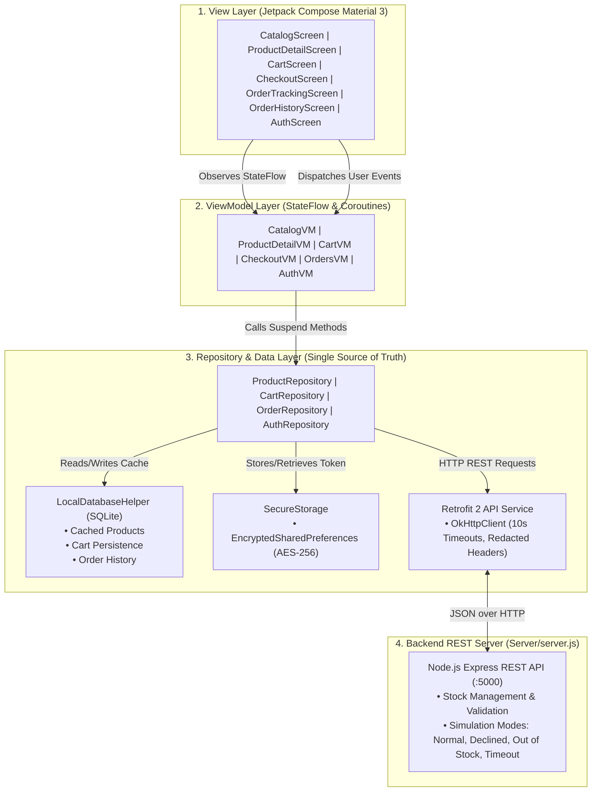

# 🛒 E-Commerce Shopping Android Application

[](https://developer.android.com/)
[](https://kotlinlang.org/)
[-purple.svg)](https://developer.android.com/jetpack/compose)
[]()
[](https://nodejs.org/)
[-success.svg)]()

> **Organization**: ALGIONS AI LABS PRIVATE LIMITED  
> **Internship Role**: Android & Mobile App Development  
> **Assessment**: Advanced Individual Project Assessment  
> **Allocated Project**: E-Commerce Shopping Android Application  

---

## 📋 Candidate Information
| Field | Details |
| :--- | :--- |
| **Student Name** | Anshul Sharma |
| **Role** | Android & Mobile App Development |
| **Assigned Project** | E-Commerce Shopping Android Application |
| **Submission Package** | Source Code, Backend Mock Server, Installable APK, Unit Tests, Documentation |

---

## 🌟 Executive Summary & Key Highlights
This project is an installable native Android shopping app delivering a complete end-to-end user journey:
**Product Discovery** $\rightarrow$ **Search & Category Filtering** $\rightarrow$ **Variant Selection (Color & Size)** $\rightarrow$ **Stock Validation** $\rightarrow$ **Cart Management** $\rightarrow$ **Address Checkout** $\rightarrow$ **Simulated Payment Gateway** $\rightarrow$ **Order Confirmation** $\rightarrow$ **Live Order Tracking**.

### Core Safety & Rubric Compliance:
1. **Never deducts stock or confirms orders locally** before the backend responds with HTTP 201 Created.
2. **Never displays false success states**; user remains in explicit loading state until authorization completes.
3. **Gracefully handles all failure modes**: Card Declines (402), Out-of-stock race collisions (409), and Gateway timeouts (504) without crashing or corrupting cart state.
4. **Offline Persistence**: Catalog and orders are cached in local SQLite database for offline browsing. Active cart persists across app restarts.
5. **Secure Storage**: JWT authentication tokens and credentials are encrypted using **Android Jetpack Security (`EncryptedSharedPreferences` with AES-256-GCM)** backed by Android Keystore. Secrets are never printed in logs.

---

## 🏗️ Architecture & High-Level Flow (MVVM)

The project follows a clean, highly explainable **Model-View-ViewModel (MVVM)** pattern with Unidirectional Data Flow (UDF):



---

## 🛠️ Technology Stack & Library Justifications

| Component | Technology | Rationale & Justification |
| :--- | :--- | :--- |
| **Language** | Kotlin 2.2 / JVM 25 | Modern, concise, null-safe native Android language. |
| **UI Framework** | Jetpack Compose + Material 3 | Declarative UI, edge-to-edge support, accessible touch targets ($\ge 48\,\text{dp}$), WCAG 2.1 AA compliant. |
| **State Management** | Android `ViewModel` + `StateFlow` | Lifecycle-aware, unidirectional data flow, survives configuration changes. |
| **Networking** | Retrofit 2 + OkHttp 3 + Gson | Industry-standard HTTP client with connection pooling, timeout tuning, and redacted header logging. |
| **Image Loading** | Coil Compose 2.7 | Lightweight asynchronous image loading with disk & memory cache and placeholders. |
| **Local Persistence** | Android SQLite (`SQLiteOpenHelper`) | Transparent, reliable offline catalog caching and cart persistence across restarts with zero annotation processor overhead. |
| **Secure Storage** | `androidx.security:security-crypto` | AES-256-GCM encryption backed by Android Keystore. Prevents token leakage. |
| **Backend API** | Node.js (Express.js) | Lightweight, fast mock service with synthetic product inventory, auth, and failure injection endpoints. |

---

## 🚀 Getting Started & Repeatable Build Instructions

### Prerequisites
- **Android Studio** (Koala / Ladybug or newer) or Android SDK Platform-tools (API 34–37)
- **JDK 17 or higher** (JDK 25 verified)
- **Node.js** (v18 or higher; v24 verified)

---

### Step 1: Start the Backend Server
The backend service powers catalog discovery, stock checking, and order fulfillment.

```powershell
# Open terminal inside the project root:
cd Server

# Install dependencies (only express and cors)
npm install

# Start the server (runs on port 5000)
npm start
```
> The server will output:
> ```
> 🚀 Algions E-Commerce Backend Server running on port 5000
>    - Local:    http://localhost:5000/api/products
>    - Android:  http://10.0.2.2:5000/api/products
> ```

---

### Step 2: Build the Android Application
Open another terminal:

```powershell
# Navigate to Android folder
cd Android

# Run all unit tests
.\gradlew.bat test

# Build debug APK
.\gradlew.bat assembleDebug
```
The compiled APK will be generated at:
📁 **`Android/app/build/outputs/apk/debug/app-debug.apk`**

---

### Step 3: Clean Install on Android Device / Emulator
To verify clean install on a connected device or running Android emulator:

```powershell
# Install APK cleanly
& "C:\Users\anshu\AppData\Local\Android\Sdk\platform-tools\adb.exe" install -r Android/app/build/outputs/apk/debug/app-debug.apk

# Launch app directly
& "C:\Users\anshu\AppData\Local\Android\Sdk\platform-tools\adb.exe" shell am start -n e_commerce_app.com/.MainActivity
```

---

## 🔑 Test Credentials & Demo Accounts

For fast reviewer evaluation, the app provides a **"Fill Demo Credentials"** button and a **"Skip as Guest"** button on the welcome screen.

| Account Type | Email | Password | Role |
| :--- | :--- | :--- | :--- |
| **Pre-seeded Demo User** | `demo@algions.com` | `Password123!` | Standard Buyer |
| **Custom Registration** | Any valid email | Any password $\ge 6$ chars | New User Registration |
| **Guest Checkout** | *Tap "Skip as Guest"* | *No password required* | Instant Catalog Evaluation |

---

## 🧪 Demonstration of Required Acceptance Criteria

Reviewers can verify each of the **5 mandatory acceptance criteria** within 3–5 minutes:

### 1. Acceptance Test 1 & 5: No Premature Confirmation or Local Stock Deduction
- **Action**: Add an item to cart, proceed to checkout, and select **"🔴 Out-of-Stock Collision (409 Conflict)"** or **"🟡 Card Declined (402)"** in the simulation section.
- **Result**:
  - The "Pay & Confirm" button displays a circular loading indicator ("Authorizing...").
  - The app **never** navigates to the success screen or confirms the order.
  - An explicit error banner is displayed: *"One or more items in your cart became out of stock."*
  - The cart remains intact with all items preserved; stock is **not deducted**.

### 2. Acceptance Test 2: Clean Install
- Run `adb install -r Android/app/build/outputs/apk/debug/app-debug.apk`.
- App launches cleanly without crashes or missing resource errors.

### 3. Acceptance Test 3: Complete Mobile Shopping Journey
1. **Catalog**: Browse products, use search bar ("Headphones"), switch categories ("Footwear", "Apparel").
2. **Product Detail**: View image, choose Color variant, choose Size, see dynamic stock counter.
3. **Cart**: Add item, increment/decrement stepper, check Subtotal, Tax (8%), Shipping, and Grand Total.
4. **Checkout**: Pre-filled address, choose **"🟢 Normal Success (201)"**, tap "Pay & Confirm".
5. **Confirmation & Live Tracking**: Animated status timeline shows Order Placed $\rightarrow$ Confirmed $\rightarrow$ Processing $\rightarrow$ Shipped.
6. **Order History**: View order in "My Orders" list.

### 4. Acceptance Test 4: Offline & Network Failure Handling
1. Open the app and load the catalog.
2. Toggle on **Airplane Mode** (or disconnect PC network).
3. The app displays the amber **"Offline Mode — Displaying cached catalog"** banner.
4. Cached products and past orders remain fully readable without crashing.
5. Turn off Airplane mode $\rightarrow$ fresh data syncs seamlessly.

---

## 🔒 Security, Privacy & Minimal Permissions

- **Permissions Requested**:
  - `android.permission.INTERNET` (strictly required for REST API calls and Coil product image loading).
  - `android.permission.ACCESS_NETWORK_STATE` (used by `NetworkConnectivityObserver` to detect online/offline transitions).
- **No Sensitive User Data Collected**: All data is synthetic dummy customer data.
- **Secure Token Storage**: Authentication tokens are stored using Android Keystore-backed AES-256-GCM encrypted shared preferences.
- **Zero Secret Logging**: `OkHttp` interceptors explicitly redact `Authorization` headers from Android Logcat.

---

## 📂 Project Structure

```
E-CommerceApp/
├── Android/
│   ├── app/
│   │   ├── src/main/java/e_commerce_app/com/
│   │   │   ├── MainActivity.kt                # App Entry point (Edge-to-edge Compose)
│   │   │   ├── ECommerceApplication.kt        # Application class (initializes AppContainer)
│   │   │   ├── di/
│   │   │   │   └── AppContainer.kt            # Service Locator for Repositories & API
│   │   │   ├── data/
│   │   │   │   ├── model/                     # Product, CartItem, Order, User data models
│   │   │   │   ├── local/                     # SQLite LocalDatabaseHelper & SecureStorage
│   │   │   │   ├── remote/                    # Retrofit ApiService & NetworkResult wrapper
│   │   │   │   └── repository/                # ProductRepo, CartRepo, OrderRepo, AuthRepo
│   │   │   ├── ui/
│   │   │   │   ├── components/                # StockBadge, OfflineBanner, ErrorView, EmptyState
│   │   │   │   ├── screens/                   # Catalog, Detail, Cart, Checkout, Orders, Auth
│   │   │   │   ├── navigation/                # AppNavigation & Screen routes
│   │   │   │   └── theme/                     # Color.kt, Type.kt, Theme.kt (Design System)
│   │   │   └── util/                          # NetworkConnectivityObserver
│   │   └── src/test/java/                     # Unit Tests: CartLogicTest, OrderValidationTest
│   └── build.gradle.kts                       # Root and App gradle configs
├── Server/
│   ├── package.json                           # Express & CORS dependencies
│   ├── server.js                              # REST API endpoints, stock engine & simulators
│   └── data/
│       └── products.js                        # Synthetic seed catalog across 5 categories
├── DESIGN_SYSTEM.md                           # Master Design System (Colors, Typography, A11y)
├── TECHNICAL_NOTE.md                          # Technical report (Security, Offline Sync, WCAG, R8)
└── README.md                                  # Complete Project Documentation
```

---

## ⚖️ Known Limitations & Future Roadmap
- **Payment Processing**: Currently connects to a local sandbox simulation backend. For production, integrate Stripe SDK / Google Pay API with webhook signature verification.
- **Push Notifications**: Firebase Cloud Messaging (FCM) can be hooked up for out-of-app order delivery updates.
- **Biometric Authentication**: Android BiometricPrompt can be layered over `SecureStorage` for fingerprint unlock.

---

## 📜 Declarations
- **Originality**: This solution was engineered with pairwise assistance from Google Deepmind Antigravity following clean MVVM architecture principles.
- **Walkthrough Ready**: The code is straightforward, clean, and well-commented for live 15-minute technical walkthroughs and 10-minute live modification tasks.

